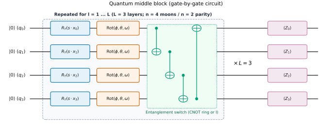

# Does the Quantum Layer Matter? An Entanglement-Ablation Study of a Hybrid Quantum–Classical Neural Network

[](https://github.com/CashewLover/hybrid-quantum-classical-nn/actions/workflows/ci.yml)
[](LICENSE)

In small hybrid quantum-classical models, a classical input layer often does enough feature mixing on its own that the contribution of the quantum circuit is hard to isolate. This project tests when a quantum middle block and its entangling gates actually change generalization, using exact 64-bit statevector simulation on simulated qubits across two moons and a four-cluster parity/XOR task. Models are compared across 20 paired random seeds under pre-specified bootstrap equivalence rules, with reports and plots built directly from raw per-seed logs.

## Research Questions

- **RQ1 (Two moons, quantum vs. classical):** When classical layers already mix features, does swapping a classical hidden block for a quantum circuit of close parameter count change test accuracy? **H1 (advance prediction):** `hybrid_entangled` minus `classical_mlp` falls inside the equivalence margin ($\delta = 0.02$).
- **RQ2 (Two moons, entanglement ablation):** On the same benchmark, does turning off the CNOT entangling ring change test accuracy? **H2 (advance prediction):** `hybrid_entangled` minus `hybrid_no_entanglement` falls inside $\delta = 0.02$.
- **RQ3 (Parity/XOR, no classical feature mixing):** When each input coordinate is scaled and shifted separately onto its own simulated qubit so features can only interact inside the circuit, is entanglement required? **H3 (advance prediction):** `parity_entangled` beats `parity_no_entanglement` by more than $\delta = 0.02$.

## Method



On two moons, all four variants share `Linear(2 -> 4) -> Tanh -> middle -> Linear(4 -> 2)` initialized from the same outer seed. The quantum middle block applies $L = 3$ re-uploading layers of $R_Y(s x_q)$ ($s = \pi$ on moons, $\pi/2$ on parity), three-angle $\mathrm{Rot}(\phi,\theta,\omega)$ gates, and a switchable CNOT ring before measuring $\langle Z_q \rangle$ (`36` middle parameters). We compare `hybrid_entangled`, `hybrid_no_entanglement`, a `classical_mlp` middle block (`40` middle parameters), and `no_middle` (`0` middle parameters). On parity/XOR, each feature gets only an independent scale and shift onto $n = 2$ simulated qubits so classical layers cannot mix coordinates, alongside an unconstrained `classical_mlp` reference. Full equations, training settings, and validation checks are in [METHODS.md](METHODS.md).

## Quick Start (Run It Yourself)

1. **Create and activate a virtual environment**

   Windows (PowerShell):
   ```powershell
   python -m venv .venv
   .venv\Scripts\Activate.ps1
   ```

   macOS and Linux:
   ```bash
   python3 -m venv .venv
   source .venv/bin/activate
   ```

2. **Install CPU PyTorch and this package**

   ```bash
   python -m pip install --upgrade pip
   python -m pip install --index-url https://download.pytorch.org/whl/cpu torch
   python -m pip install -e .
   ```

3. **Run validation checks and your own experiment**
   ```bash
   hybrid-qml doctor
   hybrid-qml run --preset standard --output results/standard
   ```
   Local runs under `results/` are gitignored so your working tree stays clean. Use `--preset quick` (`3` seeds, quarter epochs) for a ~25-second preview, `--preset smoke` (`1` seed, `2` epochs) for a sanity check.

## Requirements and Reproducibility

- **Software:** Python `3.11` through `3.14` (tested versions in [tested-versions.txt](tested-versions.txt)), `torch`, `pennylane`, `numpy`, `scipy`, `scikit-learn`, `matplotlib`, and `pillow`. Runs offline on CPU after package installation; `--device cuda` is optional, though CPU-GPU transfer overhead dominates at 2 to 4 simulated qubits.
- **Protocol tracking:** Only `--preset standard` with default flags (`20` paired seeds on CPU) is marked **confirmatory**; changing `--seeds`, `--device`, or choosing `quick`/`smoke` marks the run **exploratory**, and `< 10` seeds marks verdicts **preliminary**. Interrupted runs into the same `--output` directory skip finished seeds automatically.

## Limitations

- All circuits use classical statevector simulation on 2 to 4 simulated qubits, so nothing here supports a speed or quantum-advantage claim.
- Both tasks are small two-dimensional synthetic datasets (`300` training points, `5,000` test points).
- Expectations are computed noiselessly without shot noise, gate error, or decoherence.
- Findings apply only to this re-uploading ansatz, parameter count, and Adam training schedule.

## Citation and License

MIT License ([LICENSE](LICENSE)). Citation details are in [CITATION.cff](CITATION.cff).

## References

1. Bowles, J., Ahmed, S., & Schuld, M. (2024). *Better than classical? The subtle art of benchmarking quantum machine learning models.* arXiv:2403.07059.
2. Bergholm, V., Izaac, J., Schuld, M., et al. (2018). *PennyLane: Automatic differentiation of hybrid quantum-classical computations.* arXiv:1811.04968.
3. Paszke, A., Gross, S., Massa, F., et al. (2019). *PyTorch: An imperative style, high-performance deep learning library.* NeurIPS 2019 (arXiv:1912.01703).
4. Pérez-Salinas, A., Cervera-Lierta, A., Gil-Fuster, E., & Latorre, J. I. (2020). *Data re-uploading for a universal quantum classifier.* Quantum, 4, 226 (arXiv:1907.02085).
5. Kingma, D. P., & Ba, J. (2014). *Adam: A method for stochastic optimization.* arXiv:1412.6980.
6. Pedregosa, F., Varoquaux, G., Gramfort, A., et al. (2011). *Scikit-learn: Machine learning in Python.* Journal of Machine Learning Research, 12, 2825-2830 (arXiv:1201.0490).
