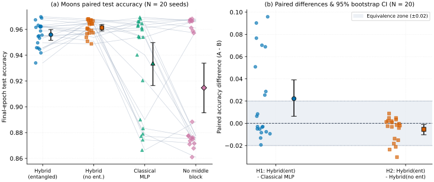
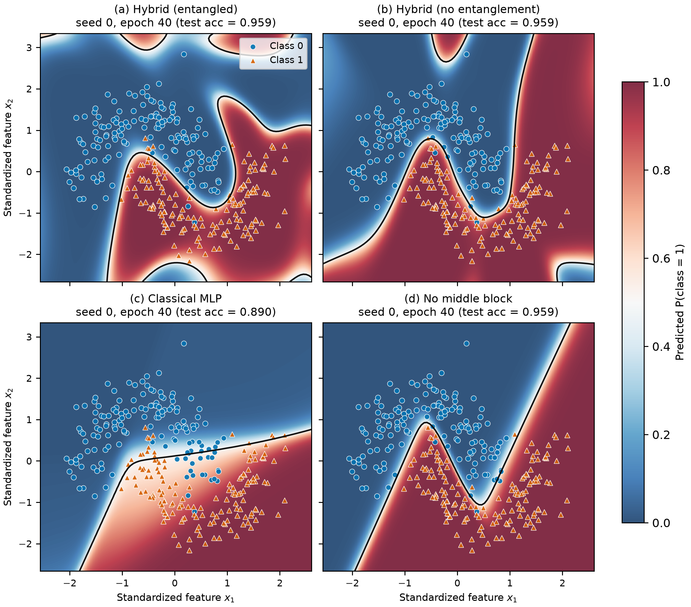
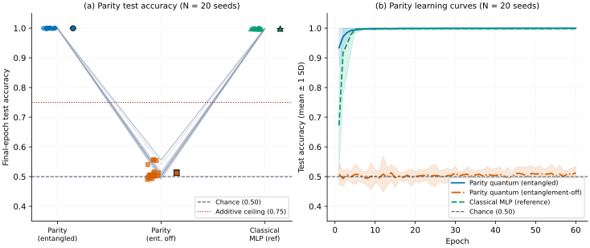
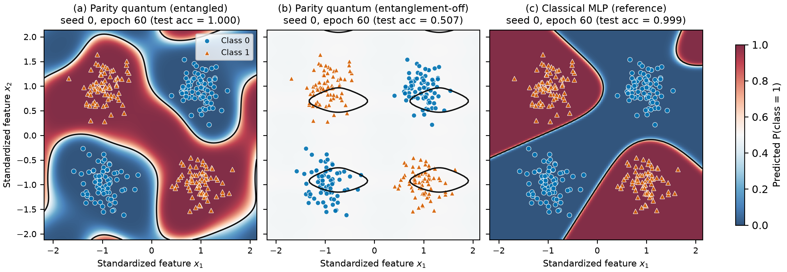

# Does the Quantum Layer Matter? An Entanglement-Ablation Study of a Hybrid Quantum–Classical Neural Network

[](https://github.com/CashewLover/hybrid-quantum-classical-nn/actions/workflows/ci.yml)
[](LICENSE)

In small hybrid quantum-classical models, a classical input layer often does enough feature mixing on its own that the contribution of the quantum circuit is hard to isolate. This project tests when a quantum middle block and its entangling gates actually change generalization, using exact 64-bit statevector simulation on simulated qubits across two moons and a four-cluster parity/XOR task. Models are compared across 20 paired random seeds under pre-specified bootstrap equivalence rules, with full raw logs and plots from our reference run included in [`reference_run/`](reference_run/).

## Research Questions

- **RQ1 (Two moons, quantum vs. classical):** When classical layers already mix features, does swapping a classical hidden block for a quantum circuit of close parameter count change test accuracy? **H1 (advance prediction):** `hybrid_entangled` minus `classical_mlp` falls inside the equivalence margin ($\delta = 0.02$).
- **RQ2 (Two moons, entanglement ablation):** On the same benchmark, does turning off the CNOT entangling ring change test accuracy? **H2 (advance prediction):** `hybrid_entangled` minus `hybrid_no_entanglement` falls inside $\delta = 0.02$.
- **RQ3 (Parity/XOR, no classical feature mixing):** When each input coordinate is scaled and shifted separately onto its own simulated qubit so features can only interact inside the circuit, is entanglement required? **H3 (advance prediction):** `parity_entangled` beats `parity_no_entanglement` by more than $\delta = 0.02$.

## Method


On two moons, all four variants share `Linear(2 -> 4) -> Tanh -> middle -> Linear(4 -> 2)` initialized from the same outer seed. The quantum middle block applies $L = 3$ re-uploading layers of $R_Y(s x_q)$ ($s = \pi$ on moons, $\pi/2$ on parity), three-angle $\mathrm{Rot}(\phi,\theta,\omega)$ gates, and a switchable CNOT ring before measuring $\langle Z_q \rangle$ (`36` middle parameters). We compare `hybrid_entangled`, `hybrid_no_entanglement`, a `classical_mlp` middle block (`40` middle parameters), and `no_middle` (`0` middle parameters). On parity/XOR, each feature gets only an independent scale and shift onto $n = 2$ simulated qubits so classical layers cannot mix coordinates, alongside an unconstrained `classical_mlp` reference. Full equations, training settings, and validation checks are in [METHODS.md](METHODS.md).

## Reference Run and Findings

The repository includes a complete 20-seed confirmatory run in [`reference_run/`](reference_run/) executed on an Intel Core i9-13900H laptop (Windows 11, Python `3.14.8`, `torch 2.15.0+cpu`, `pennylane 0.45.1`, CPU `float64`, `592.7 s` total runtime across 140 training runs; see [`reference_run/README.md`](reference_run/README.md) for all seven figures and run `hybrid-qml report reference_run` locally to generate a standalone printable `report.html`).

### Variant Summary (`N = 20` paired seeds, final epoch)

| Task | Variant | N | Test Acc (Mean ± SD) | 95% Bootstrap CI | Test Loss | Train Acc | Params (Mid / Total) | 1-Qubit Entropy (bits) |
|---|---|---:|---:|---:|---:|---:|---:|---:|
| Two moons | Hybrid (entangled) | 20 | 0.9559 ± 0.0098 | [0.9516, 0.9599] | 0.1294 | 0.9668 | 36 / 58 | 0.8285 ± 0.0219 |
| Two moons | Hybrid (no entanglement) | 20 | 0.9613 ± 0.0058 | [0.9588, 0.9638] | 0.1162 | 0.9733 | 36 / 58 | 0.0000 ± 0.0000 |
| Two moons | Classical MLP | 20 | 0.9337 ± 0.0390 | [0.9165, 0.9498] | 0.1799 | 0.9407 | 40 / 62 | - |
| Two moons | No middle block | 20 | 0.9147 ± 0.0464 | [0.8954, 0.9339] | 0.2032 | 0.9193 | 0 / 22 | - |
| Parity / XOR | Parity quantum (entangled) | 20 | 0.9996 ± 0.0008 | [0.9992, 0.9999] | 0.0023 | 1.0000 | 18 / 28 | 0.2384 ± 0.0556 |
| Parity / XOR | Parity quantum (entanglement-off) | 20 | 0.5127 ± 0.0213 | [0.5044, 0.5223] | 0.7022 | 0.5602 | 18 / 28 | 0.0000 ± 0.0000 |
| Parity / XOR | Classical MLP (reference) | 20 | 0.9982 ± 0.0015 | [0.9976, 0.9988] | 0.0071 | 1.0000 | 40 / 62 | - |

### Paired Hypothesis Verdicts (`10,000` bootstrap resamples, margin `±0.02`)

| ID | Comparison (A - B) | N | Advance Prediction | Mean Diff | 95% Bootstrap CI | Margin | Verdict | Matches Prediction |
|---|---|---:|---|---:|---:|---:|---|---|
| **H1** | Hybrid (entangled) - Classical MLP | 20 | Practically equivalent | +0.0222 | [+0.0063, +0.0391] | ±0.02 | A higher | No |
| **H2** | Hybrid (entangled) - Hybrid (no entanglement) | 20 | Practically equivalent | -0.0054 | [-0.0103, -0.0010] | ±0.02 | Practically equivalent | Yes |
| **H3** | Parity quantum (entangled) - Parity quantum (entanglement-off) | 20 | Entangled higher by more than the margin | +0.4869 | [+0.4771, +0.4954] | ±0.02 | A higher (> margin) | Yes |

### What the Run Shows

1. **Entanglement is unnecessary on two moons once classical layers mix features (H2, H1):** Although `hybrid_entangled` produced `0.8285` bits of single-qubit von Neumann entropy on average, switching the CNOT ring off (`0.0000` bits) gave practically identical test accuracy (`0.9613` vs. `0.9559`; paired difference `-0.0054`, 95% CI `[-0.0103, -0.0010]`, well inside `±0.02`). Meanwhile, `hybrid_entangled` edged out `classical_mlp` by `+0.0222` (`[+0.0063, +0.0391]`, rejecting strict `±0.02` equivalence on H1) because a few `classical_mlp` seeds lingered near `0.87-0.89` at epoch 40 whereas single-qubit $R_Y(\pi x)$ data re-uploading fit the curved boundary faster and with tighter seed-to-seed variance.
2. **Entanglement becomes essential when classical feature mixing is removed (H3):** On four-cluster parity/XOR with per-feature scale-and-shift encoding, enabling the two-qubit CNOT ring solved the task (`0.9996` mean test accuracy), while disabling it collapsed accuracy to `0.5127` (`+0.4869` paired gap, 95% CI `[+0.4771, +0.4954]`). The unconstrained `classical_mlp` reference (`0.9982`) confirms the task itself is easy once cross-feature mixing is allowed.









## Quick Start (Run It Yourself)

1. **Create and activate a virtual environment**

   Windows (PowerShell):
   ```powershell
   python -m venv .venv
   .venv\Scripts\Activate.ps1
   ```

   macOS and Linux:
   ```bash
   python3 -m venv .venv
   source .venv/bin/activate
   ```

2. **Install CPU PyTorch and this package**

   ```bash
   python -m pip install --upgrade pip
   python -m pip install --index-url https://download.pytorch.org/whl/cpu torch
   python -m pip install -e .
   ```

3. **Run validation checks and your own experiment**
   ```bash
   hybrid-qml doctor
   hybrid-qml run --preset standard --output results/standard
   ```
   Local runs under `results/` are gitignored so your working tree stays clean. Use `--preset quick` (`3` seeds, quarter epochs) for a ~25-second preview, `--preset smoke` (`1` seed, `2` epochs) for a sanity check, or `hybrid-qml report reference_run` to rebuild the reference report directly from [`reference_run/raw/`](reference_run/raw/).

## Requirements and Reproducibility

- **Software:** Python `3.11` through `3.14` (tested versions in [tested-versions.txt](tested-versions.txt)), `torch`, `pennylane`, `numpy`, `scipy`, `scikit-learn`, `matplotlib`, and `pillow`. Runs offline on CPU after package installation; `--device cuda` is optional, though CPU-GPU transfer overhead dominates at 2 to 4 simulated qubits.
- **Protocol tracking:** Only `--preset standard` with default flags (`20` paired seeds on CPU) is marked **confirmatory**; changing `--seeds`, `--device`, or choosing `quick`/`smoke` marks the run **exploratory**, and `< 10` seeds marks verdicts **preliminary**. Interrupted runs into the same `--output` directory skip finished seeds automatically.

## Limitations

- All circuits use classical statevector simulation on 2 to 4 simulated qubits, so nothing here supports a speed or quantum-advantage claim.
- Both tasks are small two-dimensional synthetic datasets (`300` training points, `5,000` test points).
- Expectations are computed noiselessly without shot noise, gate error, or decoherence.
- Findings apply only to this re-uploading ansatz, parameter count, and Adam training schedule.

## Citation and License

MIT License ([LICENSE](LICENSE)). Citation details are in [CITATION.cff](CITATION.cff).

## References

1. Bowles, J., Ahmed, S., & Schuld, M. (2024). *Better than classical? The subtle art of benchmarking quantum machine learning models.* arXiv:2403.07059.
2. Bergholm, V., Izaac, J., Schuld, M., et al. (2018). *PennyLane: Automatic differentiation of hybrid quantum-classical computations.* arXiv:1811.04968.
3. Paszke, A., Gross, S., Massa, F., et al. (2019). *PyTorch: An imperative style, high-performance deep learning library.* NeurIPS 2019 (arXiv:1912.01703).
4. Pérez-Salinas, A., Cervera-Lierta, A., Gil-Fuster, E., & Latorre, J. I. (2020). *Data re-uploading for a universal quantum classifier.* Quantum, 4, 226 (arXiv:1907.02085).
5. Kingma, D. P., & Ba, J. (2014). *Adam: A method for stochastic optimization.* arXiv:1412.6980.
6. Pedregosa, F., Varoquaux, G., Gramfort, A., et al. (2011). *Scikit-learn: Machine learning in Python.* Journal of Machine Learning Research, 12, 2825-2830 (arXiv:1201.0490).
