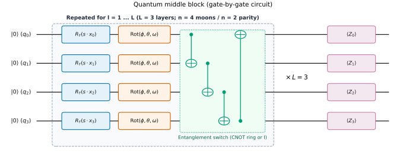
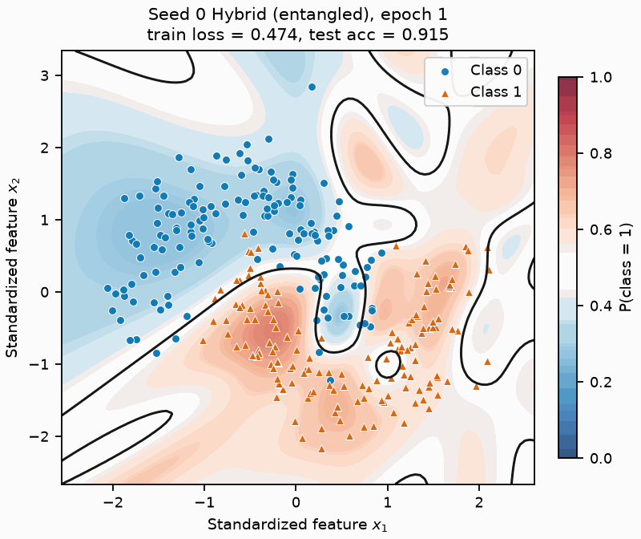
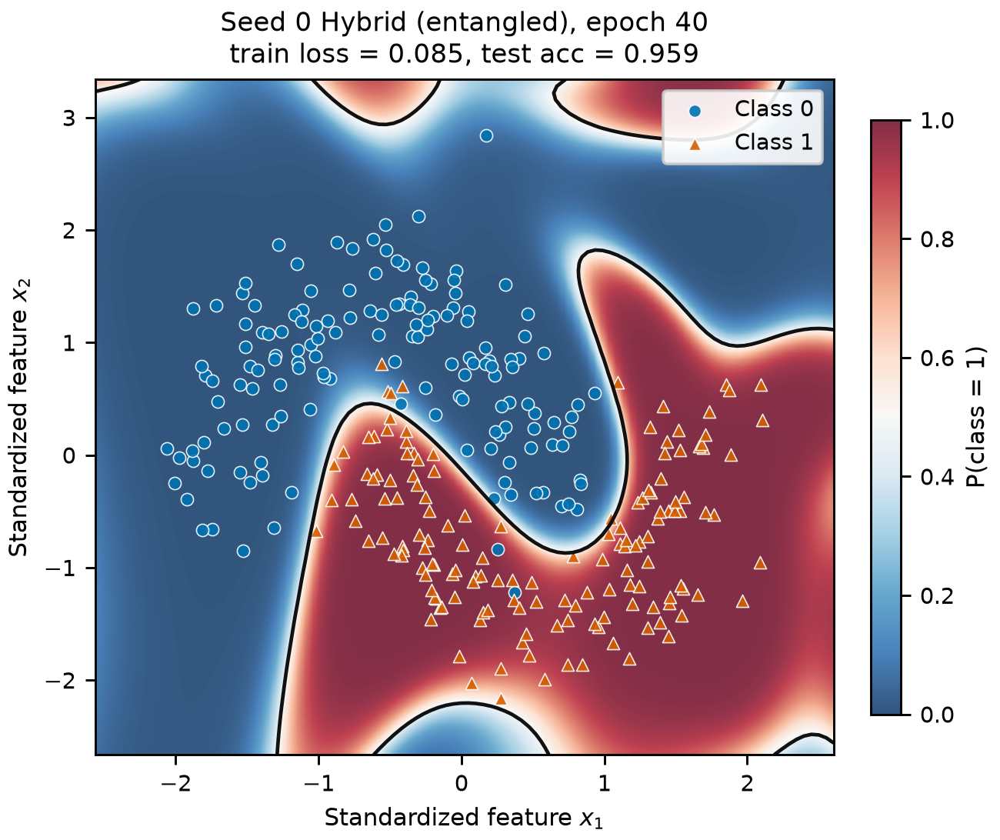
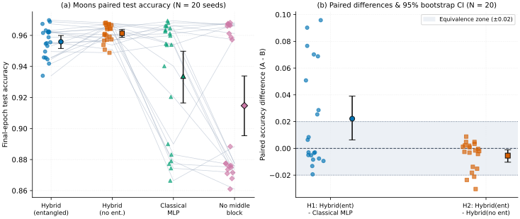
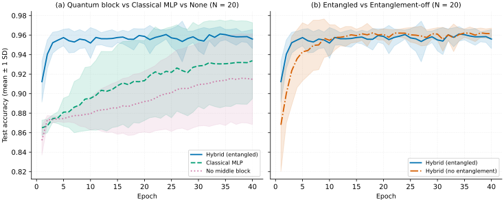
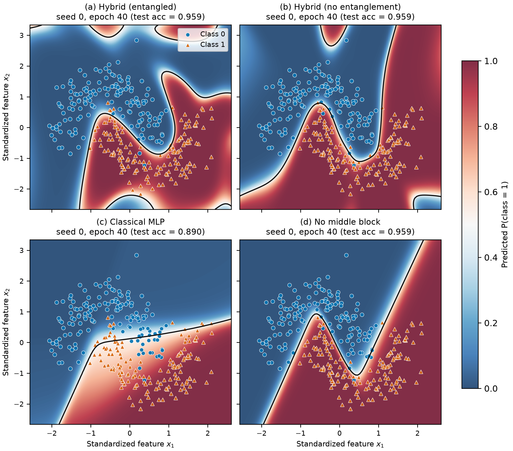
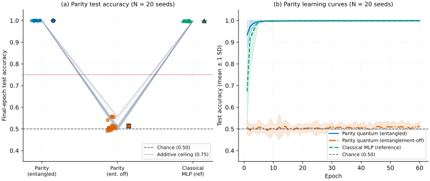
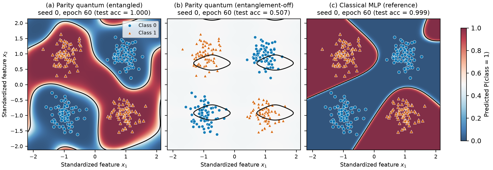

# Reference Confirmatory Run (`N = 20` Paired Seeds)

This folder stores the complete confirmatory `--preset standard` run executed on the author's machine:

- **Mode / preset:** Confirmatory (`standard`, unmodified defaults)
- **Paired seeds:** `20` (`140` training runs total; `40` moons epochs, `60` parity epochs)
- **Hardware / OS:** Intel Core i9-13900H (`20` logical cores), Windows 11 (`10.0.28000`), CPU `float64` (`592.66 s` total elapsed)
- **Code commit:** `18d6108b54` (`dirty=false` at execution)
- **Packages:** `python 3.14.8`, `torch 2.15.0+cpu`, `pennylane 0.45.1`, `pennylane-lightning 0.45.0`, `numpy 2.5.5`, `scipy 1.18.1`, `scikit-learn 1.9.1`, `matplotlib 3.11.2`, `pillow 13.0.0`
- **Raw per-seed logs:** [`raw/`](raw/) (run `hybrid-qml report reference_run` locally to generate a standalone printable `report.html`)

## Validation Checks (`hybrid-qml doctor`)

| # | Check | Result | Measured Values |
|---:|---|---|---|
| 1 | Independent reference simulator | PASS | `max_err=9.992e-16 (tol 1e-9), max_norm_dev=4.441e-16, max_bound_excess=0.000e+00` |
| 2 | Entanglement switch | PASS | `off_cross=7.772e-16, off_entropy=1.417e-15, on_cross=1.094e+00, on_entropy=0.882` |
| 3 | Autodiff vs parameter-shift gradients | PASS | `rel_l2_err=7.782e-16 (tol 1e-6)` |
| 4 | Parity no classical feature mixing | PASS | `max_cross_deriv=0.0 (must be exact 0.0), min_diag_deriv=0.910` |
| 5 | Data, pairing, and parameter counts | PASS | `moons(300/5000, params 36/36/40/0), parity(300/5000, params 18/18/40), pairing exact` |
| 6 | Negative control (shuffled labels) | PASS | `mean_shuffled_test_acc=0.4399 (|acc-0.5|=0.0601 <= 0.07)` |

## Variant Summary

| Task | Variant | N | Test Acc (Mean ± SD) | 95% CI | Test Loss | Train Acc | Params (Mid / Total) | 1-Qubit Entropy (bits) |
|---|---|---:|---:|---:|---:|---:|---:|---:|
| `e2_moons` | Hybrid (entangled) | 20 | 0.9559 ± 0.0098 | [0.9516, 0.9599] | 0.1294 | 0.9668 | 36 / 58 | 0.8285 ± 0.0219 |
| `e2_moons` | Hybrid (no entanglement) | 20 | 0.9613 ± 0.0058 | [0.9588, 0.9638] | 0.1162 | 0.9733 | 36 / 58 | 0.0000 ± 0.0000 |
| `e2_moons` | Classical MLP | 20 | 0.9337 ± 0.0390 | [0.9165, 0.9498] | 0.1799 | 0.9407 | 40 / 62 | - |
| `e2_moons` | No middle block | 20 | 0.9147 ± 0.0464 | [0.8954, 0.9339] | 0.2032 | 0.9193 | 0 / 22 | - |
| `e3_parity` | Parity quantum (entangled) | 20 | 0.9996 ± 0.0008 | [0.9992, 0.9999] | 0.0023 | 1.0000 | 18 / 28 | 0.2384 ± 0.0556 |
| `e3_parity` | Parity quantum (entanglement-off) | 20 | 0.5127 ± 0.0213 | [0.5044, 0.5223] | 0.7022 | 0.5602 | 18 / 28 | 0.0000 ± 0.0000 |
| `e3_parity` | Classical MLP (reference) | 20 | 0.9982 ± 0.0015 | [0.9976, 0.9988] | 0.0071 | 1.0000 | 40 / 62 | - |

## Hypothesis Comparisons (`10,000` bootstrap resamples, margin `±0.02`)

| ID | Comparison (A - B) | N | Prediction | Mean Diff | 95% Bootstrap CI | Margin | Verdict | Consistent |
|---|---|---:|---|---:|---:|---:|---|---|
| H1 | Hybrid (entangled) - Classical MLP | 20 | Practically equivalent | +0.0222 | [+0.0063, +0.0391] | ±0.02 | A higher | No |
| H2 | Hybrid (entangled) - Hybrid (no entanglement) | 20 | Practically equivalent | -0.0054 | [-0.0103, -0.0010] | ±0.02 | Practically equivalent | Yes |
| H3 | Parity quantum (entangled) - Parity quantum (entanglement-off) | 20 | Entangled higher by more than the margin | +0.4869 | [+0.4771, +0.4954] | ±0.02 | A higher (> margin) | Yes |

## Figures

### Figure 1: Quantum Middle Block

### Figure 2: Seed-0 Moons Training Boundary Progression (Animation and Final Epoch)
| Epoch-by-epoch animation | Final epoch (epoch 40) |
|---|---|
|  |  |

### Figure 3: Two-Moons Paired Accuracy and Differences

### Figure 4: Two-Moons Learning Curves

### Figure 5: Seed-0 Two-Moons Decision Boundaries

### Figure 6: Parity/XOR Accuracy and Learning Curves

### Figure 7: Seed-0 Parity/XOR Decision Boundaries

